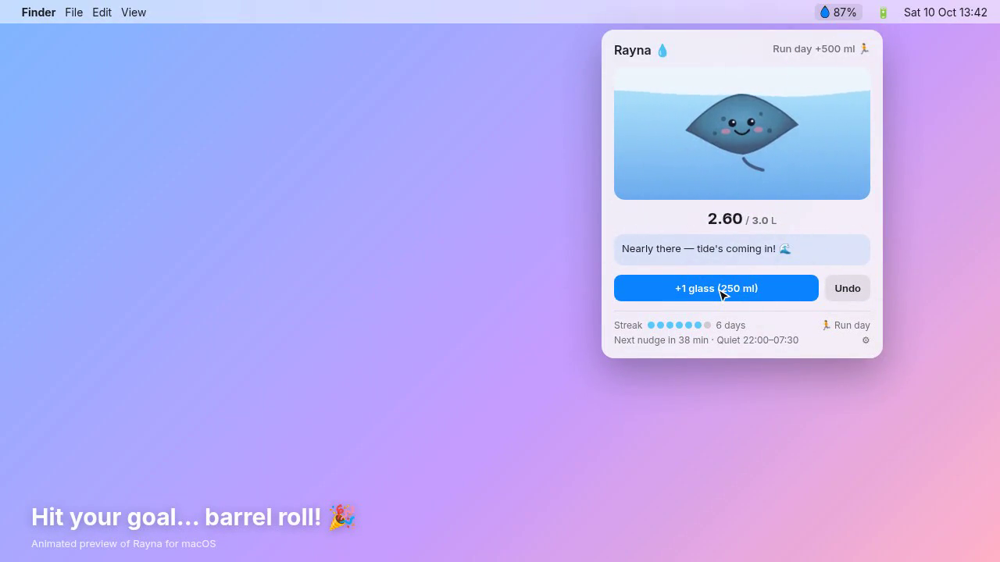

# Rayna 💧 — the happy hydration stingray

Rayna is a tiny macOS menu-bar app that reminds you to drink water. A cheerful stingray lives in your menu bar, the icon fills up as you drink, and she swims in with a friendly nudge when it's time for another glass.

**Download:** [rayna-water.netlify.app](https://rayna-water.netlify.app) (macOS 13+, Apple silicon) · [Releases](https://github.com/versantus/rayna/releases)



*(Image is from the animated preview on the website.)*

## Features
- **Menu-bar fill** — a drop icon plus a percentage of today's goal.
- **One-click logging** — "+1 glass" with undo; glass size and daily goal are configurable.
- **Animated nudges** — Rayna swims in with a speech bubble: "Drank one 💧" or "Later".
- **Run-day bonus** — toggle +500 ml on days you run.
- **Quiet hours** — no nudges overnight (default 22:00–07:30).
- **Evening pint-swap** — an optional, guilt-free "swap a pint for a pint of water" nudge after 18:00.
- **Streaks** — consecutive goal days, plus a barrel roll and confetti when you hit your goal.
- **Reduce Motion** — respects the macOS accessibility setting.

## Install
Download the DMG, drag **Rayna** into **Applications** and open it. The app is ad-hoc signed (not notarized), so on first launch: right-click Rayna → **Open** → **Open**, or go to **System Settings → Privacy & Security → Open Anyway**.

## Build from source
Requires macOS 13+ and the Xcode Command Line Tools (`xcode-select --install`); no Xcode project needed.

```sh
git clone https://github.com/versantus/rayna.git
cd rayna
./build.sh                       # builds Rayna.app (release, ad-hoc signed)
cp -R Rayna.app /Applications/
open /Applications/Rayna.app
```

Always launch `Rayna.app` (not the raw `.build` binary): notifications need the app bundle.

## License
MIT © 2026 Nik Roberts / Versantus. See [LICENSE](LICENSE).

## iPhone app (iOS 17+)

The iOS app lives in `iOS/` and shares Rayna's drawing, water, confetti, quips and data store with the Mac app via the `RaynaCore` Swift package target (`Sources/RaynaCore`).

- `iOS/project.yml` is the XcodeGen spec. Regenerate with `cd iOS && xcodegen generate`; the generated `Rayna.xcodeproj` is committed too.
- Targets: **Rayna** (`co.versantus.rayna.ios`) and **RaynaWidgetExtension** (`co.versantus.rayna.ios.widget`, small + medium widgets with an interactive “+1 glass” button). They share App Group `group.co.versantus.rayna`.
- Reminders are local notifications scheduled ~48 h ahead, with quiet hours respected. The “Drank one 💧” and “Later” (15 min snooze) actions are handled in the background.
- Icon: `iOS/scripts/make-icon.sh` renders the 1024 px icon from the shared stingray painter.
- App Store screenshots: `iOS/scripts/screenshots.sh` (demo mode via `RAYNA_DEMO=<glasses>` env / `-RaynaDemo <n>`). Metadata is in `appstore/metadata.md`.
- Archive: `cd iOS && xcodebuild -project Rayna.xcodeproj -scheme Rayna -configuration Release -destination 'generic/platform=iOS' -archivePath build/Rayna.xcarchive -allowProvisioningUpdates archive`, then `xcodebuild -exportArchive -archivePath build/Rayna.xcarchive -exportPath build/export -exportOptionsPlist ExportOptions.plist -allowProvisioningUpdates`.
