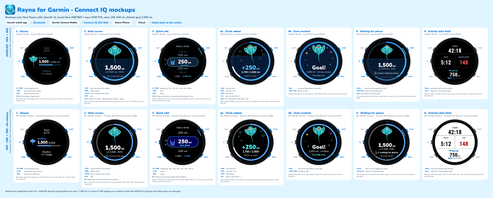

# Rayna for Garmin: plan

Status: watch app builds for fr965 and fr955 with the local Connect IQ SDK 9.1.0; the iPhone bridge builds with a
stub transport (ConnectIQ iOS SDK not linked yet) and is behind `RaynaFeatures.garmin = false`, so the shipping
app is unchanged. Nothing has been submitted to the App Store, TestFlight or the Connect IQ Store.



## 1. Architecture

```
 Garmin watch (Connect IQ watch app, Monkey C)          iPhone (Rayna iOS)                         iCloud
 ┌───────────────────────────────────────────┐   BLE   ┌──────────────────────────────────────┐
 │ Glance / Main / Quick add / Added / Goal   │  via    │ GarminBridge (iOS/Rayna/Garmin)       │
 │ RaynaStore.mc  Application.Storage:        │ Garmin  │  └ GarminTransport protocol           │
 │   queue[] of {id, op, ml, at, ref, sent}   │ Connect │     ├ ConnectIQTransport (SDK linked) │
 │   phoneML, goal, glass, streak, sizes, day │ Mobile  │     └ NoGarminTransport (stub)        │
 │ RaynaSync.mc  Communications.transmit  ────┼────────▶│ GarminBridgeCore (RaynaCore, tested)  │
 │               registerForPhoneAppMessages ◀┼─────────┤  decode → GarminLedger dedupe →       │
 │ Complication 0: ml today (watch faces)     │         │  StoreGarminSink → RaynaStore ────────┼──▶ RaynaCloudSync
 └───────────────────────────────────────────┘         │  reply: state + acks                  │    (Mac, other devices)
                                                       └──────────────────────────────────────┘
```

* **Watch** logs locally first (instant UI, works with no phone), queues every drink/undo with a unique id in
  `Application.Storage`, and transmits the queue. Items stay queued until the phone acks their id.
* **Phone** decodes, applies each id at most once (`GarminLedger`, persisted in App Group defaults), logs through the
  normal `RaynaStore` (so Health, widgets, Live Activity, Apple Watch, pods and **iCloud sync via RaynaCloudSync**
  all treat it like any glass), and replies with today's numbers + acks.
* Pure protocol code lives in `Sources/RaynaCore/Garmin/GarminProtocol.swift` (no SDK, unit tested).
  `iOS/Rayna/Garmin/GarminBridge.swift` wires it to a transport; `ConnectIQTransport.swift` is wrapped in
  `#if canImport(ConnectIQ)` so the app builds without Garmin's SDK.

## 2. Protocol v1

All messages are dictionaries (Connect IQ serialises Dictionary/Array/String/Number). `v` = protocol version.

| Direction | Message | Fields |
|---|---|---|
| watch → phone | `{"v":1,"t":"drinks","dev":"a1b2c3","items":[...]}` | up to 20 items per message |
| item | `{"id":"a1b2c3-17","op":"add","ml":250,"at":1761400000}` | `id` = 6-hex random device tag + `-` + per-watch sequence; `at` = epoch seconds when drunk |
| undo item | `{"id":"a1b2c3-18","op":"undo","ref":"a1b2c3-17","ml":250,"at":...}` | `ref` = id of the add being taken back |
| watch → phone | `{"v":1,"t":"hello","dev":"a1b2c3"}` | sent on app open / "Sync now"; asks for state |
| phone → watch | `{"v":1,"t":"state","ml":1750,"goal":2500,"glass":250,"streak":14,"band":3,"day":"2026-10-25","sizes":[150,200,250,330,400,500],"ack":["a1b2c3-17",...]}` | sent after every batch, on hello, and after any phone/iCloud change (`AppModel.afterChange/afterRemoteChange` → `GarminBridge.push()`) |

**Ids, acks, dedupe**

* The watch never deletes an item until its id appears in `ack`. A lost message or lost reply only causes a resend.
* The phone acks every id in a batch (new ones because they were just applied, known ones because they were applied
  before), and also echoes today's applied ids (capped at 60) in every state message, so a watch that missed a reply
  still clears its queue on the next state.
* Undo of an **unsent** add is resolved on the watch (item dropped). Undo of a **sent** add is a new `undo` item.
  An undo that arrives before its add is remembered; the add is then skipped (`testUndoArrivingBeforeItsAddCancelsIt`).
* Drinks queued overnight carry their real `at`, so yesterday's drink lands in yesterday's history, not today.
* Ledger forgets items older than 3 days (`GarminConfig.keepDays`).
* Malformed items are skipped, the rest of the batch still applies; unknown `t` is ignored (forward compatible).

## 3. Devices and manifest ids

Manifest app id: `2936b767488443819fd00c78b83f4018` (= `GarminConfig.appID`). Type `watch-app` with a glance,
`minApiLevel` 4.2.0 (needed for the complication publisher). Permissions: `Communications`, `ComplicationPublisher`.

| Device | Manifest product id(s) | Screen | Resources | Status |
|---|---|---|---|---|
| Forerunner 965 | `fr965` | 454 round AMOLED | `resources-round-454x454` | **in manifest, builds** |
| Forerunner 955 | `fr955` | 260 round MIP | `resources-round-260x260` | **in manifest, builds** |
| Forerunner 255 family | `fr255`, `fr255m`, `fr255s`, `fr255sm` | 260 (255S: 218) MIP | 260 (+218 set to add) | device files not downloaded in SDK Manager yet |
| fēnix 8 AMOLED | `fenix843mm` (416), `fenix847mm` (454) | AMOLED | 454 (+416 set to add) | not downloaded |
| fēnix 8 Solar | `fenix8solar47mm` (260), `fenix8solar51mm` (280) | MIP | 260 (+280) | not downloaded |
| fēnix 7 family | `fenix7` (260), `fenix7s` (240), `fenix7x` (280), `fenix7pro`, `fenix7spro`, `fenix7xpro` | MIP | 260 (+240, +280) | not downloaded |

Verify each id string in SDK Manager's device list before adding it (Garmin occasionally renames). The layout
code scales from the 454 design with `Theme.px(dc, amoledPx, mipPx)` and `Theme.amoled()`, so 416/280/240 need
only bitmap sets (`ray0..4`, `glance_ray`, `launcher_icon`) generated from `/workspace/rayna-garmin/art`.

## 4. Screens (mapped to mockups)

| Mockup | Watch code | Notes |
|---|---|---|
| 1 Glance | `GlanceView.mc` | small ray, "1,500 / 2,500 ml", thin progress bar; "N waiting" when queued |
| 2 Main | `MainView.mc` | progress ring, mood ray (5 bitmaps = RaynaFrames bands 0–4, same thresholds as `RaynaBand`), total, quiet sync line ("Synced 2m ago") |
| 3 Quick add | `PickerView.mc` | sizes 150/200/250/330/400/500 from the phone (`sizes`), the phone's glass size is the default selection and is inserted if custom |
| 4a Drink added | `AddedView.mc` (goal=false) | "+250 ml", one short buzz (50%, 150 ms), **BACK to undo**, auto-returns after 5 s |
| 4b Goal reached | `AddedView.mc` (goal=true) | "Goal!" + "The tide is in.", sparkles, two-pulse vibe; only on the drink that crosses the goal (once a day) |
| 5 Waiting for phone | `MainView.mc` waiting state | dashed ring segment for queued ml, "2 drinks waiting for phone" (MIP: "2 waiting for phone"), **no alert/vibe** |
| 6 Data field | replaced by **complication 0** | publishes ml today (`Complications.updateComplication`) for any watch face that shows third-party complications; no separate data-field app |

## 5. Buttons

| Screen | START / tap | BACK | UP / DOWN (swipe) | Hold UP (MENU) |
|---|---|---|---|---|
| Main | Quick add | exit app | — | menu: Undo last drink, Sync now |
| Quick add | add selected size | cancel | move selection | — |
| Drink added | add another (opens Quick add) | **undo** that drink | — | — |
| Goal | add another | undo | — | — |

## 6. Complication

`resources/complications.xml` declares complication id 0 (long label "Rayna water today", short "WATER", unit ml).
`RaynaSync.publish()` updates it after every add/undo and every state message from the phone. Needs API 4.2+
(all target devices). Watch faces choose it from the complication list; the native Garmin faces that support
third-party complications vary by firmware.

## 7. Limitations

* **iOS background wake.** Connect IQ messages reach the Rayna iPhone app only while it is running (foreground or
  briefly after). The ConnectIQ iOS SDK cannot wake a suspended app, and Garmin Connect Mobile does not relaunch it.
  So drinks logged on the watch wait in the watch queue ("2 drinks waiting for phone") until Rayna is opened on the
  iPhone; then the watch's next flush/hello (or the phone's push on `deviceStatusChanged(.connected)`) drains it.
  Mitigations to evaluate: send `hello` from the watch on every app open (done); push state on foreground (done);
  a Rayna widget/Live Activity reminder is the only nudge (no silent push from the watch is possible).
* The **glance** can't use Communications; it only reads storage. The main app sends.
* Garmin Connect Mobile must be installed, paired and running; the watch app must be installed from the Connect IQ
  Store (or side-loaded during development) **with the same app id** as `GarminConfig.appID`.
* Totals on the watch are "phone total + unacked queue", so a drink logged on the iPhone appears on the watch only
  after the next state message.
* `ConnectIQTransport.swift` has **not** been compiled against the real SDK yet; method names follow Garmin's
  docs and may need small fixes.
* Info.plist additions are pending until the flag is turned on: `CFBundleURLTypes` with scheme `rayna-ciq`
  (device selection callback) and `LSApplicationQueriesSchemes` containing `gcm-ciq`.
* Watch storage: the queue is unbounded in theory; in practice it holds a few days. A cap (e.g. 200 items) and
  ageing out items older than `keepDays` on the watch is a follow-up.

## 8. Test plan

1. **Unit (done, CI-able):** `swift test --filter GarminProtocolTests` (14 tests: decode, round trip, resend applied
   once and acked every time, undo before add, undo once, yesterday's drink to history, custom sizes, ledger
   persistence and pruning, state encoding).
2. **Watch simulator:** `garmin/scripts/build.sh all`, `garmin/scripts/sim.sh fr965` / `fr955`; check every screen
   (`garmin/scripts/shots.sh` captures them); in the simulator use *Settings > Connection Type* off to force the
   waiting state, then on again to see it drain.
3. **Phone ↔ simulator:** Garmin's iOS SDK cannot talk to the simulator; use a real watch (below).
4. **Real device:** side-load the `.prg` to the watch (USB: copy to `GARMIN/APPS`), link the SDK, enable the flag,
   pick the watch from Rayna Settings → "Garmin watch", then: add 3 drinks with the phone in airplane mode → watch
   shows waiting; turn phone back on and open Rayna → queue drains, total matches, iCloud shows the drinks on the Mac;
   undo on the watch removes once; kill Rayna mid-sync and reopen → no double counting.
5. **Edge:** midnight rollover with queued drinks; two watches on one phone (device tag keeps ids unique); custom
   glass size on the phone appears in Quick add; goal two-pulse fires once.

## 9. Milestones

1. ✅ Protocol + dedupe in RaynaCore with tests.
2. ✅ Watch app: all screens, offline queue, complication; builds for fr965 + fr955.
3. ✅ iOS bridge behind a protocol + stub, feature flag off; app builds.
4. ☐ Link ConnectIQ iOS SDK, fix transport compile, Info.plist scheme entries, a Settings row "Garmin watch" that
   calls `GarminBridge.shared.chooseDevices()`.
5. ☐ Download fr255/fenix 7/fenix 8 device files, add the extra resource sizes, add to manifest.
6. ☐ Real-device test on Nik's watch (test plan §8.4–8.5).
7. ☐ Store listing assets; Connect IQ Store and App Store submission **by Nik only**.

## 10. Open questions for Nik

1. Which watch do you wear day to day (to test first), and do you want fr255/fēnix 7/fēnix 8 in v1 or later?
2. Complication only (as now), or also a classic data field for activity screens?
3. Should a watch undo also be possible from the main menu after the 5 s window (it is, "Undo last drink") — keep?
4. Goal pulse: once a day even after undo + re-add (current behaviour fires again on re-crossing)?
5. Connect IQ Store name/listing: "Rayna" under which developer account?
6. OK to keep the feature flag off in the next App Store build until the real-device test is done?

## Building and running (for Nik)

```sh
# one-time
garmin/scripts/make-key.sh                 # developer key at ~/.config/rayna-garmin/developer_key.der (never commit; back it up)
# watch
garmin/scripts/build.sh all                # debug .prg per device in garmin/bin/
garmin/scripts/sim.sh fr965                # run in the Connect IQ simulator
garmin/scripts/shots.sh                    # screenshots of every screen (screen unlocked + Screen Recording permission)
# phone
swift test --filter GarminProtocolTests
cd iOS && xcodegen generate && xcodebuild -scheme Rayna -destination 'platform=iOS Simulator,name=iPhone 17 Pro' build
```

### Adding the ConnectIQ iOS SDK

1. Download the Connect IQ Mobile SDK for iOS from developer.garmin.com (Connect IQ → SDK → Mobile SDKs).
2. Put `ConnectIQ.xcframework` in `iOS/Frameworks/` (do not commit if the licence forbids redistribution; add it to
   `.gitignore` then) and add it to the Rayna target in `iOS/project.yml` (`dependencies: - framework: Frameworks/ConnectIQ.xcframework`), then `xcodegen generate`.
3. Add to the Rayna Info.plist: URL type scheme `rayna-ciq`; `LSApplicationQueriesSchemes`: `gcm-ciq`.
4. Build: `ConnectIQTransport.swift` now compiles (`canImport(ConnectIQ)`); fix any API name drift.
5. Set `RaynaFeatures.garmin = true` locally for testing only.
